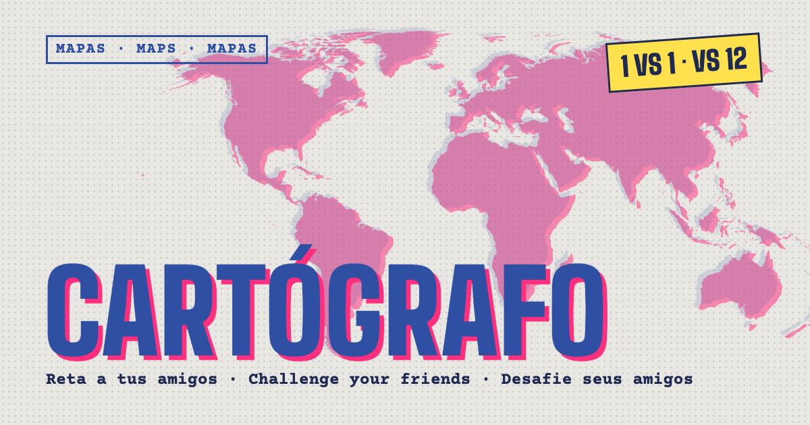
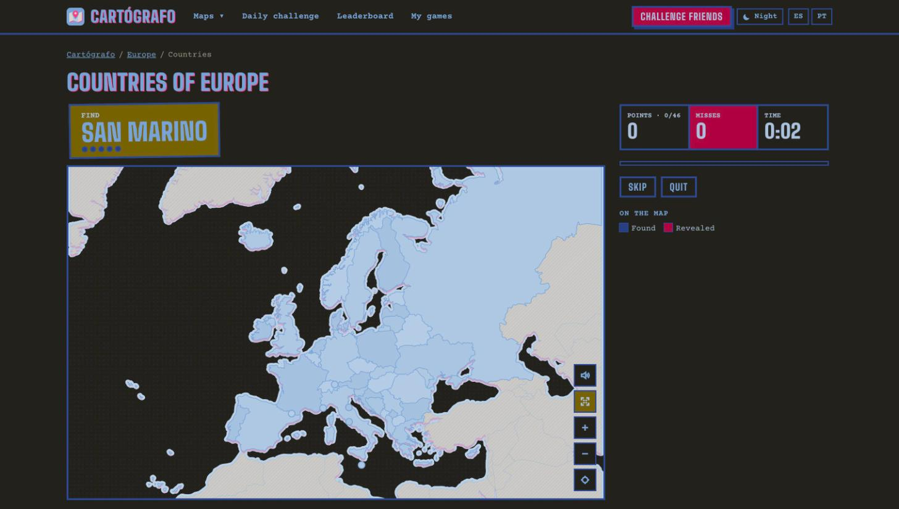

# Cartógrafo · geography duels you can play live with friends

**[cartografo.app](https://cartografo.app)** is a free multiplayer geography game that runs in the browser, on phone or computer, with no download and no sign-up. Find countries, capitals and flags on the map against the clock, take a quiz on rivers, mountains and population, or travel back to Europe in 1914 or 1989. A game takes about two minutes.

Play it in **[Spanish](https://cartografo.app/es)**, **[English](https://cartografo.app/en)**, **[Portuguese](https://cartografo.app/pt)**, **[French](https://cartografo.app/fr)**, **[German](https://cartografo.app/de)** or **[Italian](https://cartografo.app/it)**.

## Ways to play

- **Live with friends:** open a room, send the link (on WhatsApp, say) and up to 12 people play the same map at the same time, each on their own phone. You see live how far ahead or behind the leader you are, and a room scoreboard keeps the wins and points across rounds.
- **Challenge:** play a game and send the link; your friends play exactly the same pieces, in the same order, whenever they can. Only each player's first try counts, and the ranking stays on the link. [How multiplayer works](https://cartografo.app/en/multiplayer-geography-game).
- **Daily challenge:** the same map and order for everyone, once a day, with a [worldwide leaderboard](https://cartografo.app/en/leaderboard).
- **Solo:** beat your record. Each piece is worth up to 100 points: be quick, don't miss.

## Maps

73 maps, each with its own games (map, capitals, flags, quiz):

- **The world and every continent:** [world](https://cartografo.app/en/world), [Europe](https://cartografo.app/en/europe), [Asia](https://cartografo.app/en/asia), [Africa](https://cartografo.app/en/africa), [North America & Caribbean](https://cartografo.app/en/north-america-caribbean), [Central & South America](https://cartografo.app/en/central-south-america), [Oceania](https://cartografo.app/en/oceania).
- **Provinces, states and regions of 60 countries.** Europe: [Spain](https://cartografo.app/es/provincias-de-espana) (provinces and [autonomous communities](https://cartografo.app/es/comunidades-autonomas-de-espana)), [Portugal](https://cartografo.app/pt/distritos-de-portugal), [France](https://cartografo.app/fr/regions-de-france), [Italy](https://cartografo.app/it/regioni-d-italia), [Germany](https://cartografo.app/de/bundeslaender-deutschlands), the Netherlands, Belgium, Switzerland, Austria, Poland, Czechia, Ireland, Sweden, Finland, Estonia, Lithuania, Hungary, Croatia, Serbia, Romania, Bulgaria, Greece and Ukraine. The Americas: [the United States](https://cartografo.app/en/us-states), Canada, Mexico, Cuba, the Dominican Republic, Guatemala, Honduras, El Salvador, Nicaragua, Costa Rica, Colombia, Venezuela, Ecuador, Peru, [Brazil](https://cartografo.app/pt/estados-do-brasil), Bolivia, Paraguay, Chile, Argentina and Uruguay. Asia: Turkey, Saudi Arabia, Iraq, Iran, Uzbekistan, Afghanistan, Mongolia, [India](https://cartografo.app/en/states-of-india), Myanmar, Thailand, Malaysia, the Philippines, [China](https://cartografo.app/en/provinces-of-china), South Korea and [Japan](https://cartografo.app/en/prefectures-of-japan). Oceania: [Australia](https://cartografo.app/en/states-of-australia) and New Zealand.
- **Historical maps of Europe:** its countries as they were at five moments, drawn on today's coastline (see below).

All maps: [cartografo.app/en/maps](https://cartografo.app/en/maps).

## Historical maps

Could you find Austria-Hungary, Eastern Rumelia or the Free City of Danzig? Five maps of Europe's countries as they were, each with a countries game, a capitals game of the time (Kristiania, Constantinople, Kaunas, Bonn…) and a quiz; 1914 and 1989 also have a flags game.

- **[1880](https://cartografo.app/en/europe-1880):** after the Congress of Berlin. The Ottoman Empire still reaches the Adriatic; Bulgaria and Eastern Rumelia; Bosnia occupied by Austria-Hungary.
- **[1914](https://cartografo.app/en/europe-1914):** on the eve of the First World War. Four empires, and no Poland.
- **[1938](https://cartografo.app/en/europe-1938):** between the wars. Danzig, the Polish Corridor, Czechoslovakia whole, Lithuania with Kaunas as capital.
- **[1945](https://cartografo.app/en/europe-1945):** the end of the Second World War. Germany in four occupation zones; Poland moved west.
- **[1989](https://cartografo.app/en/europe-1989):** the end of the Cold War. Two Germanys, the Soviet Union, Yugoslavia, Czechoslovakia.

The borders are built from today's countries and regions where the old border follows them, and from lines drawn by hand where it does not, good to about 10 km; every map is checked against a list of cities that must fall in the right state.

## Made for

- [Killing time](https://cartografo.app/en/games-to-kill-time) or [a wait](https://cartografo.app/en/games-to-play-while-waiting) on your phone.
- [A table of friends](https://cartografo.app/en/games-to-play-at-a-restaurant) while the food arrives, or [friends far away](https://cartografo.app/en/online-games-to-play-with-friends).
- [Learning geography](https://cartografo.app/en/learn-geography-games), at home or [in class](https://cartografo.app/en/geography-games-for-the-classroom): the whole class plays at once, no accounts.
- [Flag quizzes](https://cartografo.app/en/flag-quiz) and [geography games for kids](https://cartografo.app/en/geography-games-for-kids).

## Who makes it

I'm Oscar, from Tarragona (Spain). I love travelling and learning the geography of a place before I go. Playing with a friend to see who knew the map better, we looked for something quick to challenge each other live, each on our own phone, and found nothing, so I built Cartógrafo. [The full story](https://cartografo.app/en/about).

Ideas, bugs or a map you would like to see: **hola@cartografo.app**.

## Under the hood

A static Next.js site with live rooms on Cloudflare (Workers and Durable Objects). Maps from Natural Earth and Spain's IGN (the historical ones too, cut along the borders of the time), capitals from Wikidata, flags from flag-icons and Wikimedia Commons; the historical flags are drawn for the game. The game's source is not public.

---

**Español:** Cartógrafo es un juego de geografía gratis para retar a tus amigos en directo: encuentra países, capitales y banderas en el mapa en partidas de dos minutos. [Jugar en cartografo.app/es](https://cartografo.app/es).

**Português:** O Cartógrafo é um jogo de geografia grátis para desafiar os amigos ao vivo: encontre países, capitais e bandeiras no mapa em partidas de dois minutos. [Jogar em cartografo.app/pt](https://cartografo.app/pt).

**Français :** Cartógrafo est un jeu de géographie gratuit pour défier tes amis en direct : trouve des pays, des capitales et des drapeaux sur la carte en parties de deux minutes. [Jouer sur cartografo.app/fr](https://cartografo.app/fr).

**Deutsch:** Cartógrafo ist ein kostenloses Geografie-Spiel für Live-Duelle mit Freunden: Finde Länder, Hauptstädte und Flaggen auf der Karte, in Runden von zwei Minuten. [Spielen auf cartografo.app/de](https://cartografo.app/de).

**Italiano:** Cartógrafo è un gioco di geografia gratuito per sfidare gli amici in diretta: trova paesi, capitali e bandiere sulla mappa in partite da due minuti. [Gioca su cartografo.app/it](https://cartografo.app/it).
